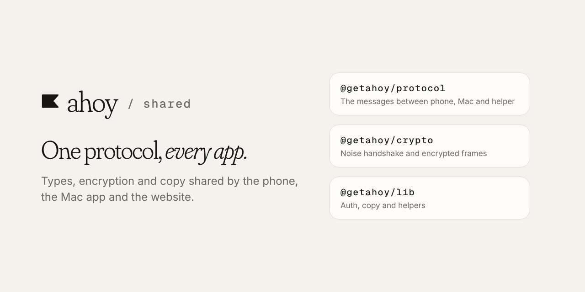

**Ahoy** is a voice assistant that lets you control your Mac from your phone. This repo holds the code every Ahoy app shares.

[▶ Watch the 1:45 demo](https://drive.google.com/file/d/1JMgSd2bm7LtUCs2WxiTNWuo0-bijqs4p/view?usp=sharing) · [All Ahoy repos](https://github.com/getahoy)

# Ahoy shared

A pnpm workspace used by [mobile](https://github.com/getahoy/mobile), [agent](https://github.com/getahoy/agent) and [web](https://github.com/getahoy/web), so the phone, the Mac and the server always speak the same language.

| Package | What it is |
|---|---|
| `@getahoy/protocol` | The messages between the phone, the Mac app and the helper, with their schemas |
| `@getahoy/crypto` | The Noise handshake and encrypted frames for the phone-to-Mac connection |
| `@getahoy/lib` | Auth helpers, shared copy and small utilities |

## Setup

```bash
pnpm install
pnpm build
```

The other repos import these packages from `../shared/packages/*`, so clone this repo next to them and build it first.

## Scripts

| Script | Does |
|---|---|
| `pnpm build` | Builds every package |
| `pnpm typecheck` | `tsc` in every package |
| `pnpm lint` | Biome checks |
